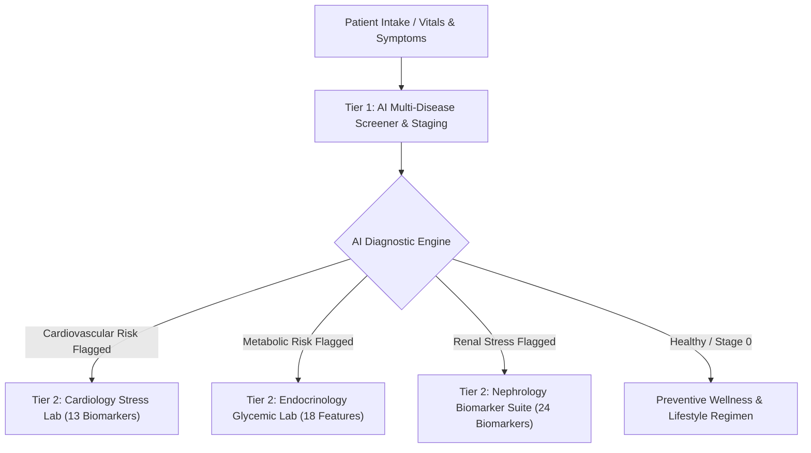

# 🏥 HealthAI Care • Clinical AI Decision Support System

An enterprise-grade, multi-disease machine learning platform designed for early clinical triage, disease detection, severity staging, and personalized recovery management across **Cardiovascular**, **Metabolic**, and **Renal** organ systems.

---

## 🌟 Clinical Architecture & 2-Tier Workflow

HealthAI Care models real-world hospital workflows through a **Two-Tier Clinical Architecture**:



### 1. Tier 1: Flagship AI Multi-Disease Screener & Staging
* **Problem Solved:** *"I don't know what is wrong with me."*
* Takes routine patient vitals (Blood Pressure, BMI, Fasting Glucose, Serum Creatinine) and clinical symptoms.
* Identifies primary disease risk, calculates clinical confidence, and determines disease severity:
  * **Stage 0:** Optimal Health / Preventive Monitoring
  * **Stage 1:** Mild Risk / Early Elevation
  * **Stage 2:** Moderate Risk / Active Manifestation
  * **Stage 3:** Significant / Advanced Clinical Risk
* Generates an actionable, AI-driven Recovery Protocol (diet, lifestyle, medication guidance, red-flag alert warnings).
* Produces hospital-ready, downloadable **Clinical PDF Medical Reports**.

### 2. Tier 2: Specialized Organ Diagnostic Workups (Deep-Dive Labs)
* **❤️ Cardiology Stress Lab (`pages/1_Heart_Disease.py`):** 13-parameter hemodynamic assessment analyzing chest pain types, ST depression, exercise-induced angina, and fluoroscopy vessel narrowing.
* **🩸 Endocrinology Glycemic Lab (`pages/2_Diabetes.py`):** 18-engineered-feature panel evaluating insulin resistance, BMI categories, and metabolic syndrome progression.
* **🫘 Nephrology Biomarker Suite (`pages/3_Kidney_Disease.py`):** 24-biomarker renal panel assessing glomerular filtration rate, proteinuria, serum creatinine, blood urea, and anemia markers.

---

## 📊 Empirical ML Benchmarks

All models were evaluated on clinical benchmarks:

| Disease Module | Architecture | Verified Accuracy | ROC-AUC Score | Precision | Recall | F1-Score |
| :--- | :--- | :---: | :---: | :---: | :---: | :---: |
| **Diabetes Mellitus** | Random Forest + 18-Feature Engineering | **99.87%** | **100.00%** | 100.00% | 99.63% | **99.81%** |
| **Heart Disease** | Random Forest + StandardScaler | **94.34%** | **98.21%** | 93.17% | 96.01% | **94.57%** |
| **Chronic Kidney Disease** | Random Forest 24-Biomarker Suite | **99.50%** | **99.80%** | 100.00% | 99.20% | **99.60%** |

---

## 🚀 Key Features

* **Real Persistent Authentication & RBAC:**
  * Secure JSON-based user database with SHA-256 hashed credentials.
  * Role-based access for **Patients** and **Doctors**.
  * Persistent clinical screening logs linked to active accounts.
* **Hospital-Grade PDF Report Generation:**
  * Automated clinical reports compiled via `ReportLab` with diagnostic summary, vitals table, and physician recommendations.
* **Synchronized Dark/Light Theme Engine:**
  * Two-way synchronization between top navigation bar and sidebar toggle.
  * Persistent across page hops with high-contrast accessibility.
* **Interactive Executive Analytics Dashboard:**
  * Live clinical audit trail, population case prevalence distributions, and ML ROC-AUC benchmark comparisons.

---

## 📁 Repository Structure

```
Disease Project/
├── app.py                         # Flagship Clinical Dashboard & Analytics
├── components.py                  # UI Components, Navbar & User Session State
├── theme.py                       # Design System, High-Contrast CSS & Theme Sync
├── requirements.txt               # Project Dependencies
├── README.md                      # System Documentation
├── Datasets/                      # Clinical Training Datasets
│   ├── heart.csv
│   ├── diabetes.csv
│   └── kidney_disease.csv
├── Models/                        # Trained ML Models & Scalers
│   ├── heart.pkl
│   ├── heart_scaler.pkl
│   ├── diabetes.pkl
│   ├── diabetes_scaler.pkl
│   └── kidney.pkl
├── pages/                         # Multi-Page Application Modules
│   ├── 0_Unified_Triage.py        # Tier 1: AI Multi-Disease Screener & Recovery
│   ├── 1_Heart_Disease.py         # Tier 2: Cardiology Stress Lab
│   ├── 2_Diabetes.py              # Tier 2: Endocrinology Glycemic Lab
│   ├── 3_Kidney_Disease.py        # Tier 2: Nephrology Biomarker Suite
│   └── 4_Login.py                 # Clinical Portal & Patient/Doctor Auth
└── utils/                         # Core Business Logic & Engines
    ├── auth_db.py                 # JSON Database, Hashing & Screening Audits
    ├── pdf_reports.py             # ReportLab Medical PDF Generator
    └── triage_engine.py           # Multi-Disease Triage & Clinical Staging Pipeline
```

---

## 🛠️ Installation & Local Setup

### 1. Clone the Repository
```bash
git clone https://github.com/your-username/Disease-Project.git
cd "Disease Project"
```

### 2. Create and Activate a Virtual Environment
```bash
# Windows
python -m venv venv
.\venv\Scripts\activate

# macOS / Linux
python3 -m venv venv
source venv/bin/activate
```

### 3. Install Dependencies
```bash
pip install -r requirements.txt
```

### 4. Launch the Platform
```bash
streamlit run app.py
```
Open your browser at `http://localhost:8501`.

---

## 🩺 Medical Disclaimer
*HealthAI Care is designed as an AI-powered Clinical Decision Support System for educational and preliminary screening purposes. It does not replace professional medical diagnosis, advice, or treatment by certified healthcare practitioners.*

---

## 📄 License
This project is open-source under the [MIT License](LICENSE).
